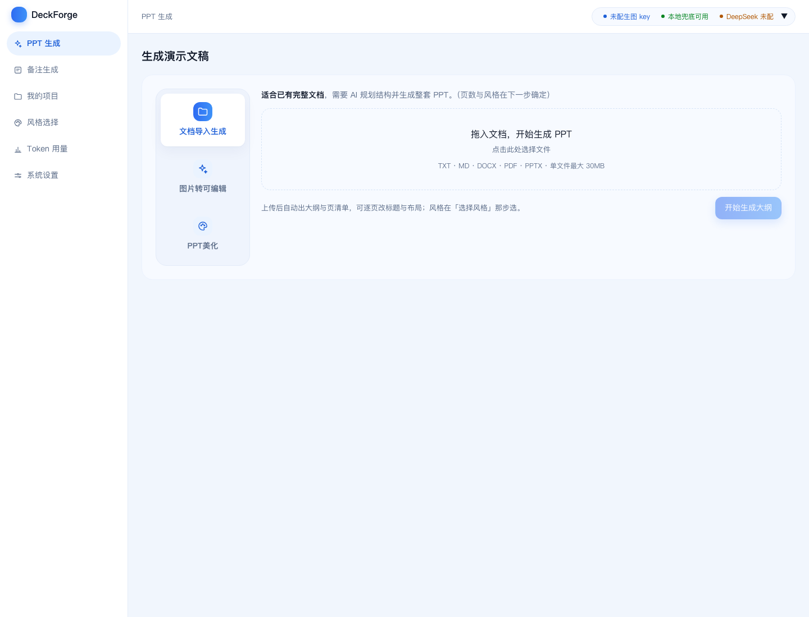
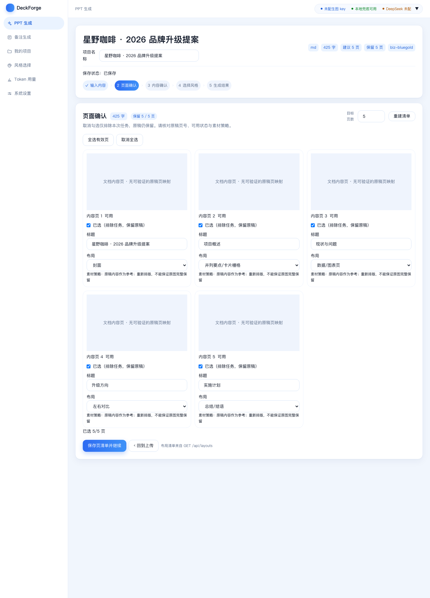
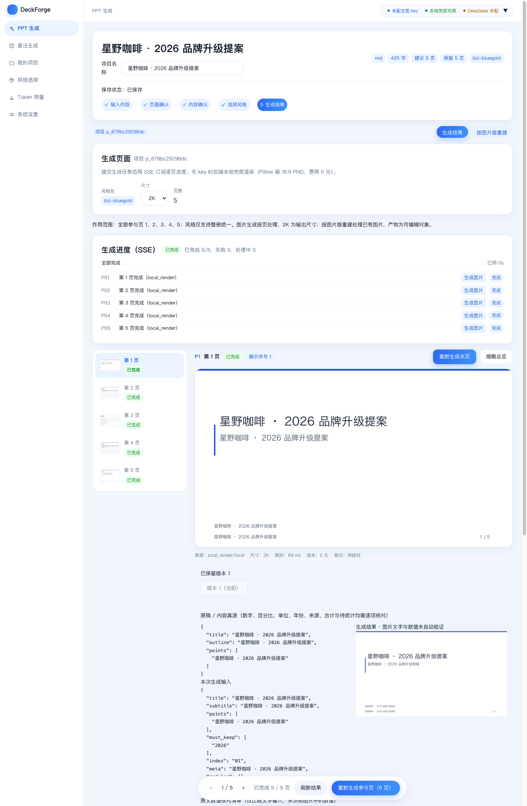
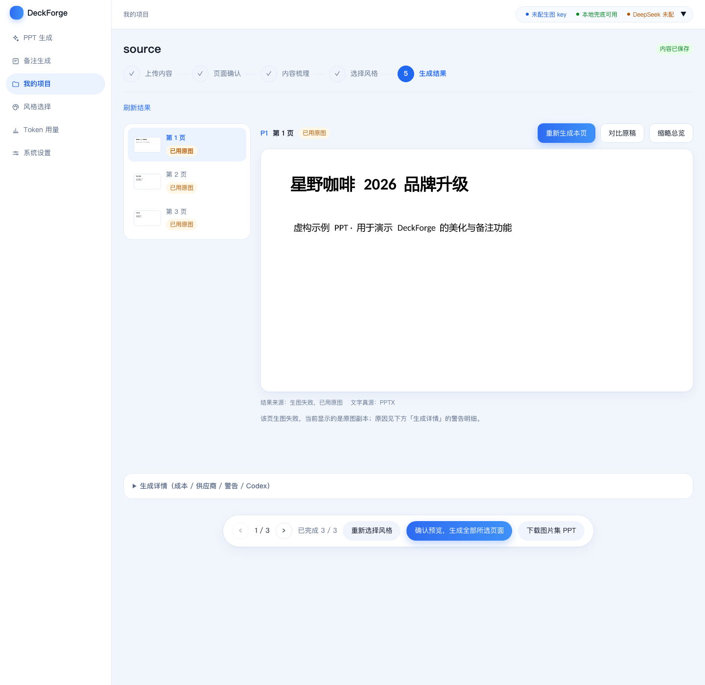
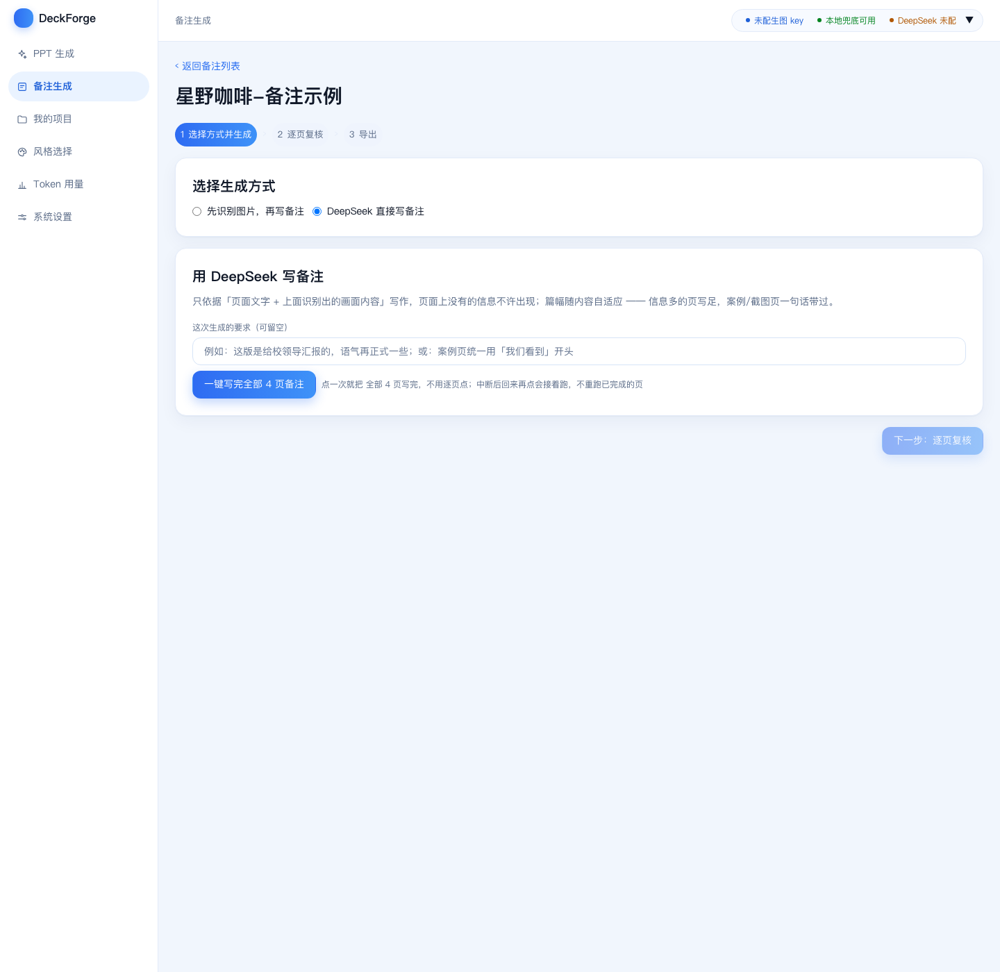
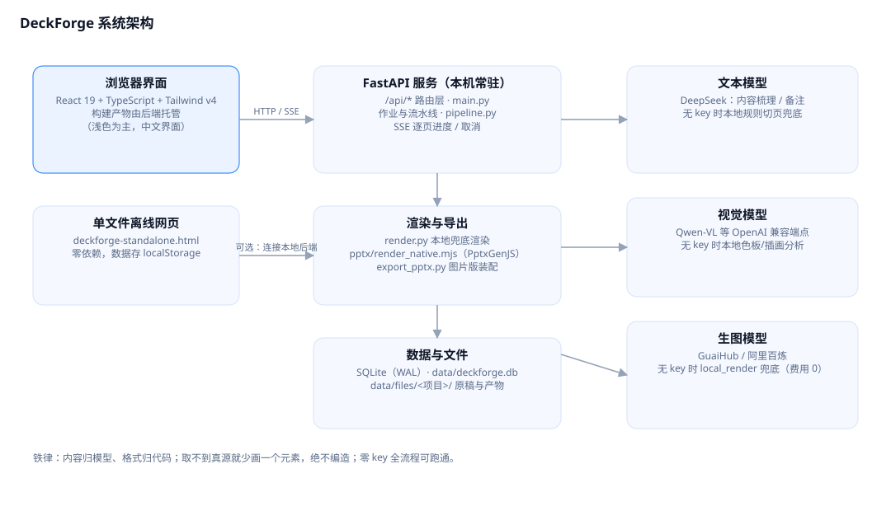

# DeckForge · 智能 PPT 生成工作台

自托管的「内容 → 一整套风格统一 PPT」工作台。上传 Markdown / TXT / DOCX / PDF / PPTX（或直接粘贴文本），
它会梳理页面、按你选的风格逐页出图，最后导出**图片版 PPTX** 或**原生可编辑 PPTX**（文字、形状、图表都是 PowerPoint 原生对象）。

**没有配置任何模型密钥也能跑通全流程**——大纲走本地规则切页、出图走本地兜底渲染（费用 0 元），这条底线在仓库里被当成铁律。

> 下载地址：**<https://github.com/dhk1413-del/deckforge>**
> ```bash
> git clone https://github.com/dhk1413-del/deckforge.git
> cd deckforge && bash server/start-lan.sh   # 然后打开 http://127.0.0.1:8641
> ```
> 完整安装、配置与逐步操作见 **[docs/使用说明.md](docs/使用说明.md)**（另有可打印的 [PDF](docs/使用说明.pdf) / [Word](docs/使用说明.docx)）。

---

## 界面预览

以下截图全部来自**中性演示数据**（虚构品牌「星野咖啡」）与零 key 的本地兜底渲染，不含任何真实项目内容。

| 首页：三条流程入口 | 生成向导：页面确认 |
|---|---|
|  |  |

| 生成结果：逐页查看与导出 | 风格库 |
|---|---|
|  |  |

| PPT 美化：逐页结果 | PPT 备注：逐页写备注 |
|---|---|
|  |  |

其余截图（向导五步、风格详情、我的项目、设置、用量账本）见 [`docs/screenshots/`](docs/screenshots/)。

---

## 能做什么

| 流程 | 输入 | 产出 |
|---|---|---|
| **① 文档导入生成** | Markdown / TXT / DOCX / PDF / PPTX / 粘贴文本 | 整套 PPT：图片版 + 原生可编辑版 |
| **② PPT 美化** | 已有的 `.pptx` / `.pdf` | 逐页 AI 生图（图生图或重新设计）→ 图片集 PPT + Codex 重建的可编辑版 |
| **③ 图片转可编辑** | PDF / 图片 / PPTX | 用第三方精细重建引擎把原页文字与形状还原成可编辑对象（约 13 分钟/页） |
| **④ PPT 备注** | 已有的 `.pptx` | 逐页演讲者备注写回备注栏（不动页面内容与版式） |

外加：**风格库**（7 套内置风格包 + 从你的样本 PPTX/PDF/图片实测生成自定义风格）、**我的项目**（卡片列表、点击回到上次执行到的步骤）、**用量账本**（按动作/供应商/项目汇总费用）、**设置**（密钥、模型、网络模式热加载）。

---

## 系统架构



后端 FastAPI + SQLite(WAL)，前端 React 19 + TypeScript + Tailwind v4（构建产物由后端托管）；
另有零依赖的单文件离线网页 `deckforge-standalone.html`，双击即可离线使用（数据存浏览器 localStorage）。

---

## 快速开始

```bash
git clone https://github.com/dhk1413-del/deckforge.git
cd deckforge

# 1) 前端构建（仓库不含构建产物）
cd web && npm install && npm run build && cd ..

# 2) 启动（首次启动会自动创建 .venv 并安装 Python 依赖 / PptxGenJS）
bash server/start-lan.sh          # 默认 http://127.0.0.1:8641
```

打开 <http://127.0.0.1:8641> 即可。**没有任何密钥时**系统会使用本地内容切分与本地兜底渲染，全流程与导出照常可用。

- 停止：`bash server/stop-daemon.sh`
- 重启（改完后端代码后）：`bash server/stop-daemon.sh && bash server/start-lan.sh`
- 看门狗（服务掉了自动拉起）：见 [使用说明 §1.4](docs/使用说明.md)
- 局域网访问：`HOST=0.0.0.0 PORT=8641 bash server/start-lan.sh`（服务无鉴权，仅限可信网络）

### 配置模型

在界面的「设置」页填写密钥即可（保存后**无需重启**，存在本机数据库里，不进仓库）；也可以复制 `config/.env.example` 为 `config/.env`。

| 用途 | 默认 | 无密钥时 |
|---|---|---|
| 生图 | GuaiHub（GPT Image）/ 阿里百炼 | 本地 `local_render` 兜底，费用 0 |
| 文本（内容梳理 / 备注） | DeepSeek | 本地规则切页 / 明确提示未配置 |
| 视觉（图片理解） | 阿里百炼 Qwen-VL（可指向任意 OpenAI 兼容端点） | 本地色板与插画区域分析 |

> 费用口径：未填生图单价时账本金额记 **0**，界面会明确写「不代表免费」。

---

## 自检

```bash
make verify        # 14 套离线回归 + 前端构建 + 线上只读冒烟（服务在跑时用）
make verify-fast   # 只跑回归与构建：不联网、不调模型、不花钱
make lint          # 后端字节码编译 + 前端 tsc
```

回归覆盖：美化 v2 真源与缓存、图片转可编辑导入、原稿缩略图、渲染器不伪造内容与数据、视觉解析宽容性、
生图重试与链路切换、讲稿备注、风格构建，以及 M5/M6/M7 的项目阶段、导出快照与列表一致性。

---

## 目录结构

```
server/app/          FastAPI 后端：路由、流水线、渲染、导出、风格包、美化、备注、风格构建
server/pptx/         原生可编辑 PPTX 渲染器（PptxGenJS）——唯一排版真源
web/src/             React 前端（pages / components / hooks）
style-packs/         风格包（style.md + prompt.md + 预览图）与版式定义
ui-design/           设计令牌与组件规范（浅色为主，主色 #1E78FA）
tools/               离线回归、端到端验收、流程图生成、验证脚本
docs/                使用说明、API 契约、验收矩阵、截图与流程图
config/              供应商配置模板（密钥由用户填写，不进仓库）
```

---

## 说明与声明

- **演示素材**：仓库里的界面截图来自虚构品牌「星野咖啡」的演示数据；风格包的预览图是脚本合成的示例图（图上已标注），
  可用 `tools/gen_diagrams.py` 之外的合成脚本重新生成，或用你自己的样本替换。
- **内容与数据不造假**：渲染器与前端不写死业务文案；图表只画有真源的数据，取不到就不画并如实标注。
- **本机自托管**：服务默认只监听 `127.0.0.1`，没有登录鉴权；如需局域网访问请自行评估风险。
- 第三方组件与许可：FastAPI / Uvicorn / Pillow / PyMuPDF / python-pptx / PptxGenJS / React / Tailwind CSS 等，遵循各自许可证。

## 许可证

本仓库未附带开源许可证文件；如需对外分发，请先补充 `LICENSE`（例如 MIT）并确认第三方依赖许可兼容。
