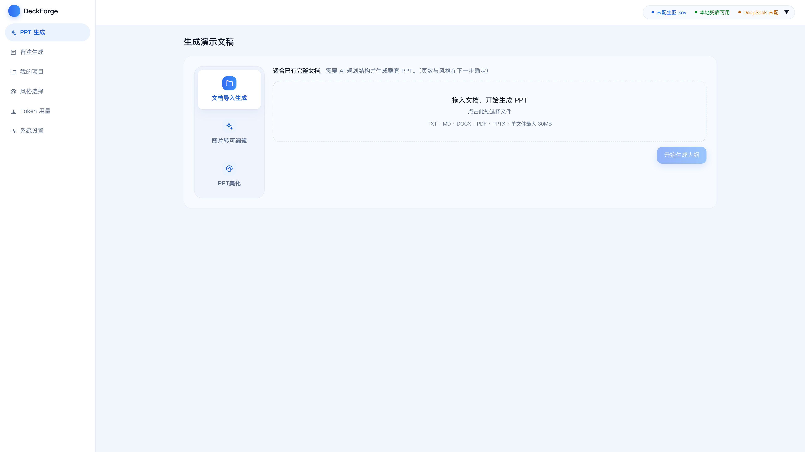
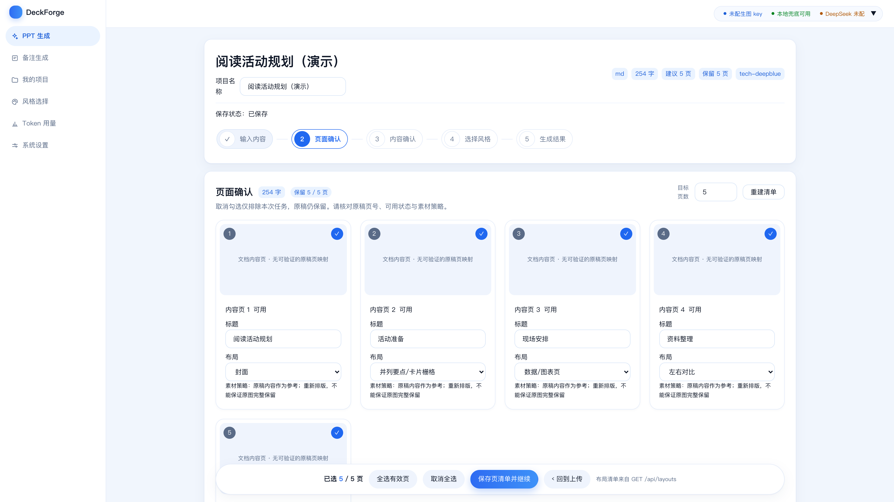
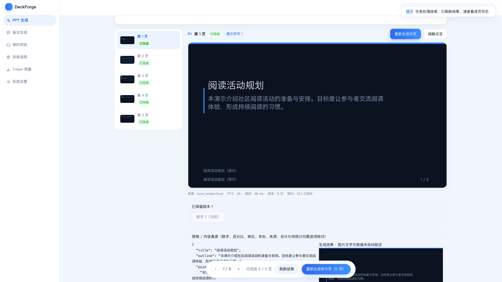

# DeckForge

自托管的 PPT 生成工作台。上传 Markdown、TXT、DOCX、PDF 或 PPTX（也可以直接粘贴文本），
它会梳理页面、按选定风格逐页出图，最后导出图片版 PPTX 或原生可编辑 PPTX。

没有配置任何模型密钥时，大纲走本地规则切页、出图走本地兜底渲染，费用为 0，流程和导出都能走通。

下载地址：<https://github.com/dhk1413-del/deckforge>

## 安装

支持 macOS；Windows 使用 WSL2 Ubuntu。三种方式任选一种：

1. **DeepSeek Harness 帮装**：从 [DeepSeek 官方页面](https://www.deepseek.com/zh/harness/) 获取工具，在新会话里粘贴 [安装要求](docs/使用说明.md#1-用-ai-助手帮你安装)。
2. **WorkBuddy 帮装**：从 [腾讯官方下载页](https://www.codebuddy.cn/downloads/) 获取 WorkBuddy，使用同一段安装要求，让它完成下载、安装和启动。
3. **手动安装**：先准备 Python（推荐 3.12）、Node.js 22 系列最新版（至少 22.12）、Git；处理 PPTX 还需 LibreOffice。Windows 先准备 WSL2，详细步骤见 [手动安装](docs/使用说明.md#2-手动安装)。

```bash
git clone https://github.com/dhk1413-del/deckforge.git
cd deckforge
npm --prefix web install
npm --prefix web run build
bash server/start-lan.sh
```

首次启动会自动安装其余依赖；出现“已就绪”后打开 **http://127.0.0.1:8641**。

[图文使用说明](docs/使用说明.md) · [PDF](docs/使用说明.pdf) · [Word](docs/使用说明.docx) · [HTML 阅读版](docs/使用说明.html)

## 能做什么

| 流程 | 输入 | 产出 |
|---|---|---|
| 文档导入生成 | Markdown / TXT / DOCX / PDF / PPTX / 粘贴文本 | 整套 PPT，图片版和原生可编辑版 |
| PPT 美化 | 已有的 .pptx / .pdf | 逐页生图（图生图或重新设计）→ 图片集 PPT 和可编辑版 |
| 图片转可编辑 | PDF / 图片 / PPTX | 用第三方引擎把原页文字和形状还原成可编辑对象，约 13 分钟一页 |
| PPT 备注 | 已有的 .pptx | 逐页演讲者备注，写回备注栏，不动页面内容 |

另外还有风格库（7 套内置风格，也可以从样本实测生成）、我的项目（点进去回到上次的步骤）、用量账本和设置页。

## 界面

截图来自当前系统的隔离演示实例，原始视口截图为 **3840×2160**。
文档生成使用零密钥本地渲染；美化截图显示“已用原图”；转换和备注展示准备状态。

| 首页 | 页面确认 |
|---|---|
|  |  |

| 生成结果 | 风格选择 |
|---|---|
|  |  |

| PPT 美化预览 | 演讲备注 |
|---|---|
|  |  |

[高清系统截图](docs/screenshots/current/) · [ImageGen 功能图解](docs/illustrations/)

## 架构


后端 FastAPI + SQLite(WAL)，前端 React 19 + TypeScript + Tailwind v4，构建产物由后端托管。
仓库里还有一个零依赖的单文件版本 `deckforge-standalone.html`，双击就能离线用，数据存在浏览器里。

## 配置模型

在「系统设置」页填密钥即可，保存后立即生效，密钥存在本机数据库，不进仓库。
也可以用 `config/.env`（模板见 `config/.env.example`）。

| 用途 | 默认 | 没配密钥时 |
|---|---|---|
| 生图 | GuaiHub 或阿里百炼 | 本地兜底渲染，费用 0 |
| 文本 | DeepSeek | 本地规则切页，或提示未配置 |
| 视觉 | 阿里百炼 Qwen-VL，可指向任意 OpenAI 兼容端点 | 本地色板和插画分析 |

生图单价留空时账本金额记 0，界面会说明这不代表免费。

## 命令

第一次跑自检前先执行一次 `bash server/start-lan.sh`：它会装好 Python 依赖与 `server/pptx` 的
PptxGenJS（原生可编辑导出要用），否则相关用例会失败。`tools/verify_all.py` 检测到缺依赖时也会提示。

```bash
bash server/start-lan.sh        # 启动（脱离终端常驻）
bash server/stop-daemon.sh      # 停止
make verify                     # 14 套离线回归 + 前端构建 + 线上只读冒烟
make verify-fast                # 不联网、不调模型、不花钱
make lint                       # 后端编译 + 前端 tsc
```

局域网访问用 `HOST=0.0.0.0 PORT=8641 bash server/start-lan.sh`。服务没有登录鉴权，只在可信网络里用。

## 目录

```
server/app/      FastAPI 后端：路由、流水线、渲染、导出、风格包、美化、备注、风格构建
server/pptx/     原生可编辑 PPTX 渲染器（PptxGenJS），排版真源
web/src/         React 前端
style-packs/     风格包与版式定义
ui-design/       设计令牌与组件规范
tools/           离线回归、端到端验收、流程图生成、文档转换
docs/            使用说明、API 契约、验收记录、截图、流程图
config/          供应商配置模板
```

## 说明

- 仓库里的界面截图取自中性演示数据；`style-packs/*/previews/` 里是各风格的真实样例页。
- 渲染器和前端不写死业务文案；图表只画有真源的数据，没有就不画并标注来源。
- 服务默认只监听 127.0.0.1，没有登录鉴权。
- 仓库暂未附带开源许可证，对外分发前先补 `LICENSE`，并确认第三方依赖的许可兼容。
