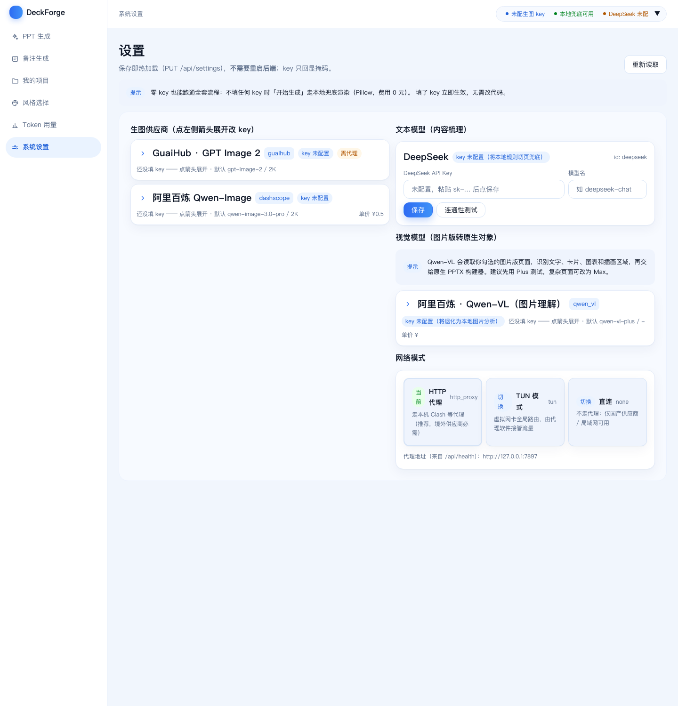
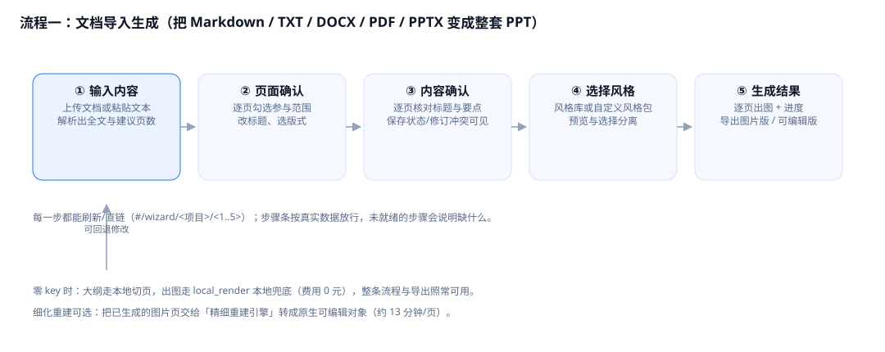
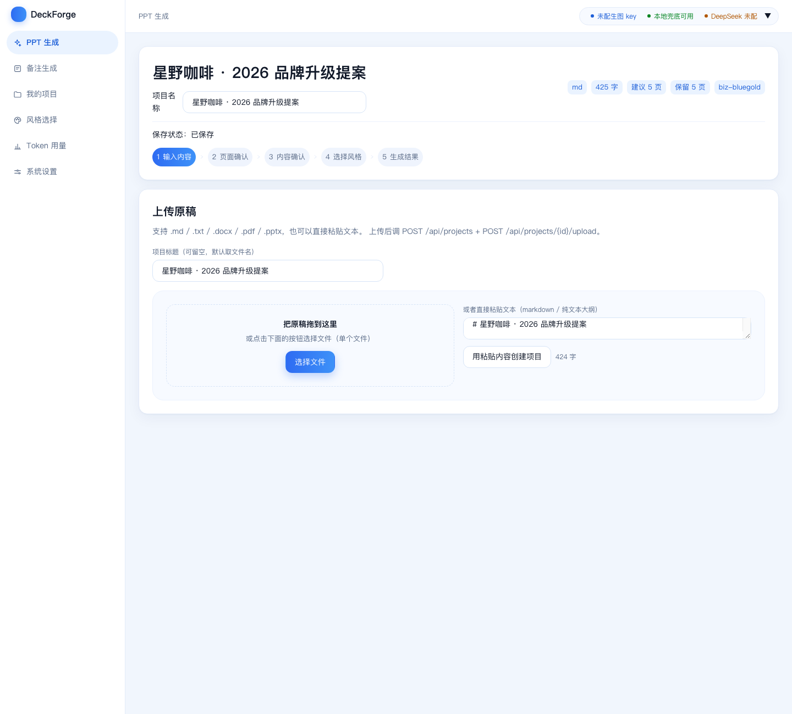
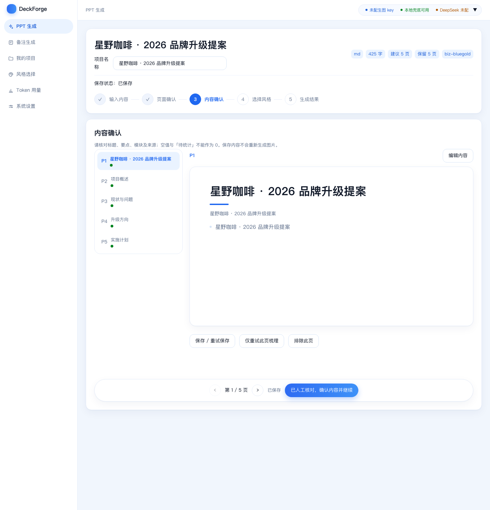
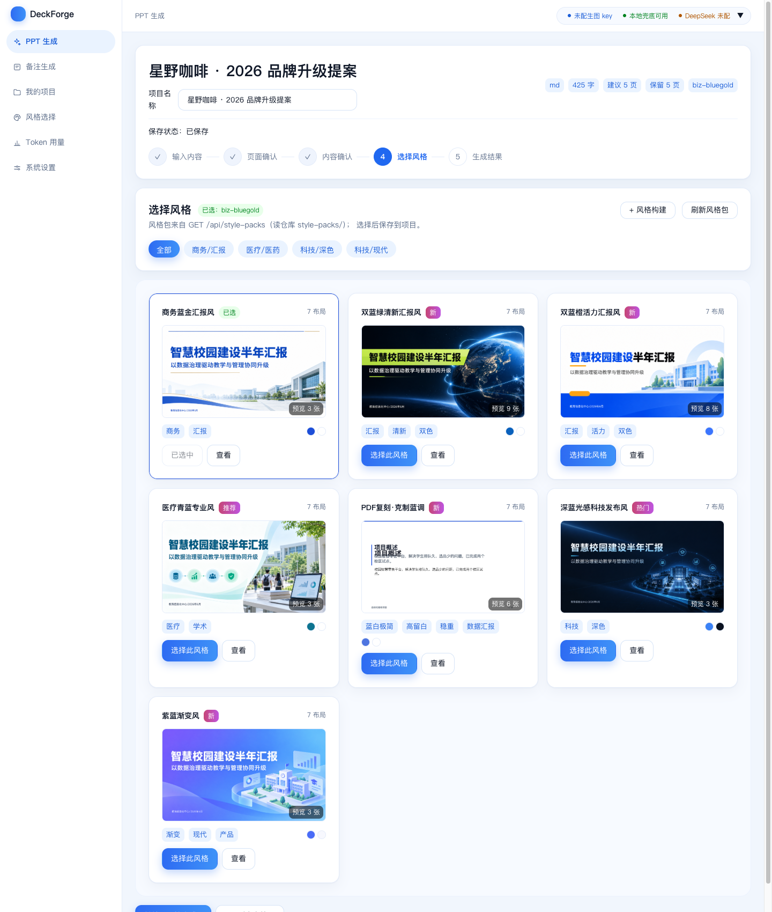
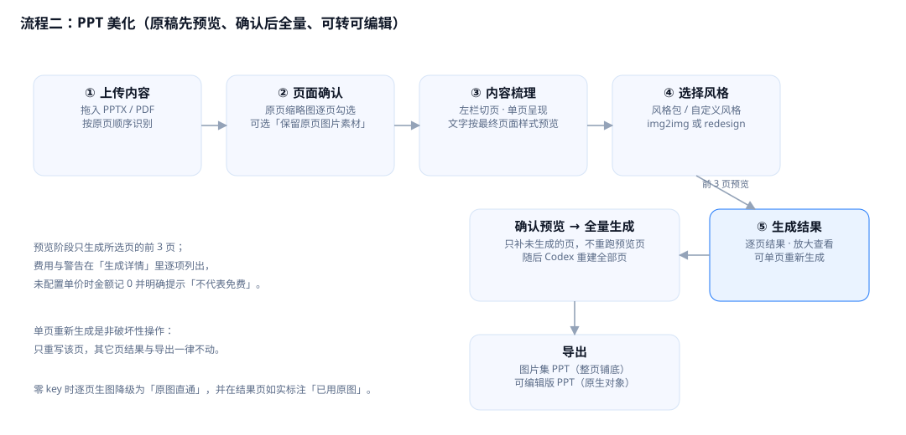
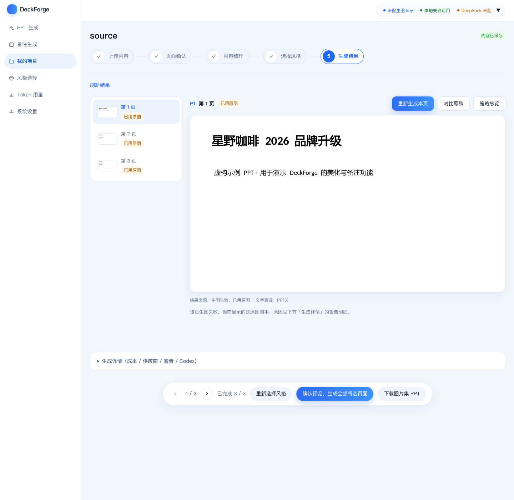
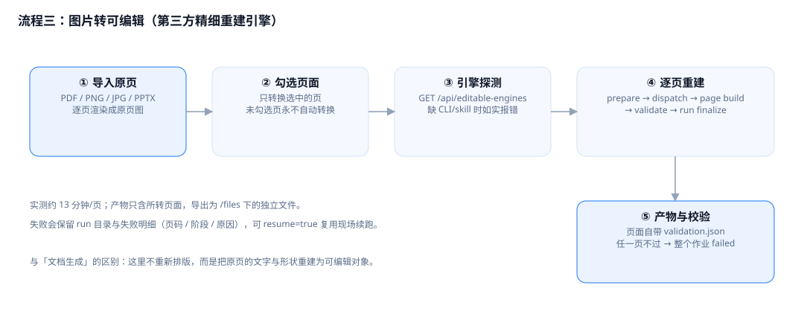
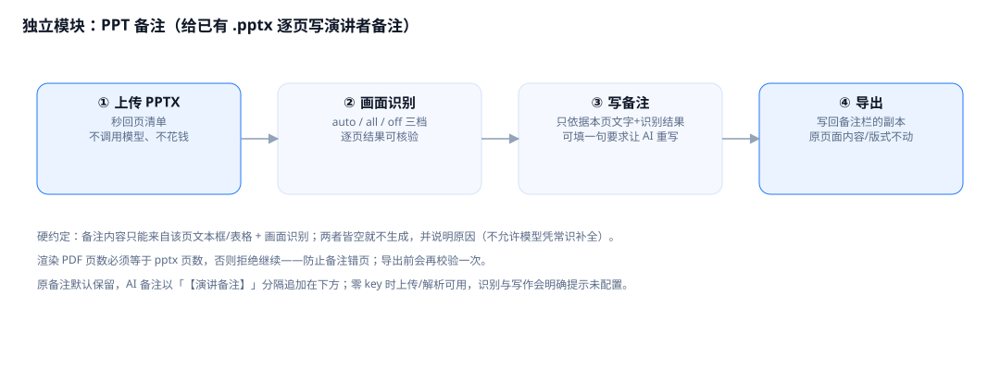
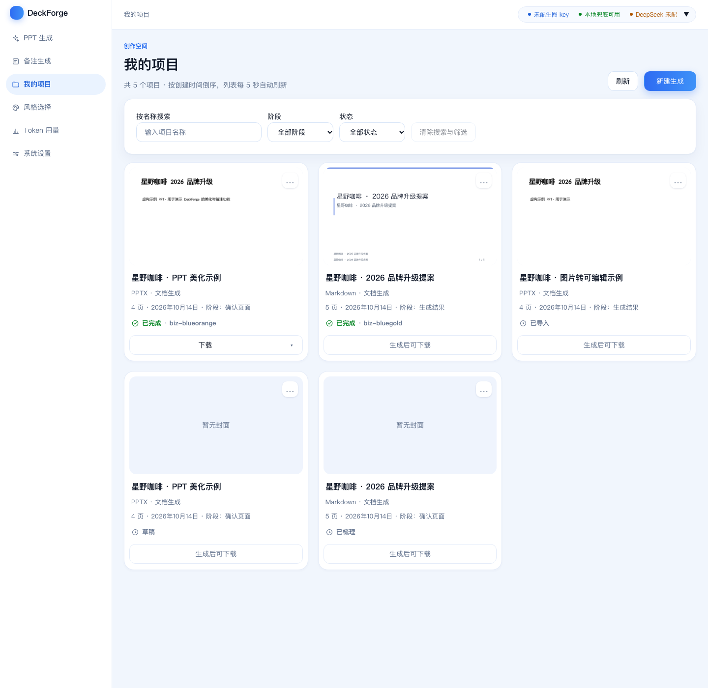

# DeckForge 使用说明

下载地址：<https://github.com/dhk1413-del/deckforge>

```bash
git clone https://github.com/dhk1413-del/deckforge.git
cd deckforge
```

这份说明写给从 GitHub 下载后自己部署的人。第 1 章先装好并启动（不想手动敲命令就直接看 1.2），第 3–8 章讲各流程怎么用，遇到问题看第 11 章。
文中的截图取自演示数据（虚构品牌「星野咖啡」），没有真实项目内容。

---

## 1. 部署与启动

### 1.1 需要装什么

| 组件 | 版本 | 说明 |
|---|---|---|
| Python | 3.9 及以上 | 后端 |
| Node.js + npm | 18 及以上 | 前端构建；`server/pptx` 的依赖脚本会自动装 |
| LibreOffice | 近期版本 | 处理 PPTX 时需要（pptx 要先转 PDF 才能逐页渲染） |
| Codex CLI | 可选 | 只有「PPT 美化」全量重建可编辑版用到 |
| 精细重建引擎 | 可选 | 只有「图片转可编辑」用到 |

只处理 Markdown、TXT 或粘贴文本时不需要 LibreOffice。不配任何密钥也能跑完整流程，见 1.7。

### 1.2 方法一：让 agent 工具帮你装（以 WorkBuddy 为例）

本机装了桌面 agent 的话，安装这件事可以直接交给它。下面以 **WorkBuddy**（腾讯，本机路径 `/Applications/WorkBuddy.app`）为例，
其它能执行终端命令的 agent（Cursor、Claude Code、Codex 等）同样适用。

1. 打开 WorkBuddy，新建一个对话。
2. 把下面这段原样粘进去。它会自己克隆仓库、装依赖、构建前端、启动服务，并把自检结果回报给你。

```text
帮我在本机把这个开源项目跑起来：https://github.com/dhk1413-del/deckforge

要求：
1) 克隆到 ~/Documents/deckforge（目录已存在就跳过克隆，不要覆盖我已有的改动）
2) 进入 web/ 执行 npm install && npm run build
3) 回到仓库根执行 bash server/start-lan.sh
   注意：首次启动会自动创建 .venv 并安装 Python 依赖与 PptxGenJS，需要几分钟，不要中断
4) 用 curl -s --noproxy '*' http://127.0.0.1:8641/api/health 确认返回里有 "ok": true
5) 跑 make verify-fast，把它打印的真实结果行（「通过 N 项，失败 M 项」和「N 项检查：N 通过 / 0 失败」）发给我
6) 任何一步失败，把原始报错贴出来，说明原因和你要怎么改，先别自己改代码

约束：不要修改 data/ 里的文件，不要把任何密钥写进仓库或代码，也不要做 git commit。
最后告诉我访问地址和你执行过的命令。
```

3. 它跑完后，自己打开 <http://127.0.0.1:8641> 看一眼就行。
4. 如果它中途问你要 API key，可以先不给：不配任何密钥也能跑通全流程（见 1.7）。

几点注意：

- agent 需要有执行终端命令的权限，macOS 可能弹窗要求允许 Python 接收本地网络连接，点允许。
- 工作目录别放在会被同步盘实时扫描的位置，首次 `npm install` 会比较慢。
- WorkBuddy 的会话产物一般落在 `~/WorkBuddy/<时间戳>/` 下，装完后可以在那里翻它的执行记录。

### 1.3 方法二：手动安装

```bash
git clone https://github.com/dhk1413-del/deckforge.git
cd deckforge

cd web && npm install && npm run build && cd ..
bash server/start-lan.sh          # 默认 127.0.0.1:8641
```

后端依赖不用手动装。第一次执行启动脚本时，脚本会创建 `.venv`、安装 `server/requirements.txt`、安装 `server/pptx` 的 Node 依赖。

**首次启动要等一会儿**（取决于网络，通常几分钟）：脚本会提示「首次启动：正在安装依赖」并每 30 秒报一次进度，装完自动就绪。
如果它报「启动未就绪」，多半是依赖还没装完——等安装跑完后重新执行一次 `bash server/start-lan.sh` 即可。
前端那一步（`cd web && npm install && npm run build`）需要自己先执行，否则页面打不开。

### 1.4 启动、停止、重启

```bash
bash server/start-lan.sh                              # 启动，默认 127.0.0.1:8641
bash server/stop-daemon.sh                            # 停止
bash server/stop-daemon.sh && bash server/start-lan.sh # 重启（改完后端代码）
```

然后打开 <http://127.0.0.1:8641>。

不要在终端里前台跑 `bash server/run.sh`：会话结束时进程会被带走，页面就打不开了。重启后可以这样确认服务已脱离终端：

```bash
ps -o pid,ppid -p $(cat data/logs/deckforge.pid)      # PPID 应为 1
curl -s --noproxy '*' http://127.0.0.1:8641/api/health  # "ok": true
```

### 1.5 看门狗

`server/watchdog.sh` 每 60 秒探一次健康检查，不是 200 就用当前的 HOST/PORT 重新拉起服务，日志在 `data/logs/watchdog.log`。

macOS 没有 `setsid`，用新会话方式启动：

```bash
python3 - <<'PY'
import os, subprocess
subprocess.Popen(["bash", "server/watchdog.sh"], cwd=os.getcwd(), stdin=subprocess.DEVNULL,
                 stdout=subprocess.DEVNULL, stderr=subprocess.DEVNULL, start_new_session=True)
PY

pkill -f 'server/watchdog.sh'    # 停止
tail -f data/logs/watchdog.log   # 看日志
```

### 1.6 局域网访问

```bash
HOST=0.0.0.0 PORT=8641 bash server/start-lan.sh
```

服务没有登录鉴权，同网段的人都能改密钥、上传和下载文件。只在可信网络里用，不要暴露到公网。
macOS 首次可能弹防火墙授权，要允许 Python 接收本地网络连接。

### 1.7 不配密钥也能跑

没有任何密钥时：内容梳理走本地按段落切页；出图走本地兜底渲染（Pillow 把结构化内容画成 16:9 PNG），
provider 记 `local_render`，费用记 0；图片理解退化为取该页色板与插画裁片。流程和两种导出都照常可用。

可以先零成本走一遍，确认排版和流程没问题，再决定哪一页值得花钱调真实模型。

### 1.8 端口和数据目录

| 变量 | 默认 | 说明 |
|---|---|---|
| `PORT` / `DECKFORGE_PORT` | 8641（`server/run.sh` 默认 8640） | 端口 |
| `HOST` / `DECKFORGE_HOST` | 127.0.0.1 | 监听地址 |
| `DECKFORGE_DATA` | 仓库下的 `data/` | 数据目录：数据库、原稿、渲染图、导出件 |

把 `DECKFORGE_DATA` 指到别处就是一套隔离实例，测试时不会动到正式数据：

```bash
DECKFORGE_DATA=/tmp/deckforge-demo PORT=8650 bash server/start-lan.sh
```

---

## 2. 配置模型

### 2.1 在设置页填（推荐）

打开「系统设置」，填密钥，点「连通性测试」确认可用。保存后立即生效，不用重启。密钥存在本机数据库里，不会进仓库。



| 卡片 | 用途 | 没配密钥时 |
|---|---|---|
| 生图 | 逐页出图 | 本地兜底渲染，费用记 0 |
| 文本 | 内容梳理、备注写作（DeepSeek） | 本地规则切页；备注模块会提示未配置 |
| 视觉 | 读图（Qwen-VL 或任意 OpenAI 兼容端点） | 本地色板与插画区域分析 |

### 2.2 用配置文件

复制 `config/.env.example` 为 `config/.env`，填 `DEEPSEEK_API_KEY`、`GUAIHUB_API_KEY`、`DASHSCOPE_API_KEY` 等。
供应商端点和默认模型在 `config/providers.yaml`、`config/text-models.yaml` 里改。

### 2.3 网络模式

设置页有 `http_proxy`、`tun`、`none` 三种。境外端点按这个模式走代理，国内端点（百炼、DeepSeek）一律直连。
如果用 TUN 类客户端接管了全局流量，选 `tun`，并把 `HTTP_PROXY`/`HTTPS_PROXY` 清空，否则两层代理会互相打架。

### 2.4 单价和费用

「单价（元/张）」留空时账本金额记 0，界面会写明这不代表免费。填了单价就按单价乘张数记账，失败调用也会记录。

---

## 3. 流程一：文档导入生成



### 输入内容



拖入 `.md`、`.txt`、`.docx`、`.pdf`、`.pptx`，或者直接在「粘贴文本」里贴内容。
上传后会解析全文，给出建议页数和字数；PPTX 会按真实页序建立页清单。

### 页面确认


逐页勾选是否参与生成，取消勾选只是排除本次任务，原稿还在。每页可以改标题、选版式
（封面、并列要点、左右对比、数据图表、时间线、总结等）。右下角「保存页清单并继续」才进入下一步。

### 内容确认



逐页核对标题、正文要点和表格模块，可以就地改。保存状态（未保存、正在保存、已保存、保存失败）和
多窗口编辑的修订冲突都会如实提示。内容改过之后，已有的生成结果会被标成「基于旧内容」，需要重新生成。

### 选择风格



风格库内置 7 套风格。点「查看」看大图预览，预览不等于选中。也可以上传参考文件生成自己的风格包，见第 7 章。

### 生成结果


左边是页面列表，带结果缩略图和每页状态；右边是当前页的大图，点图可以放大，用方向键翻页，Esc 关闭。
顶部「重新生成本页」只重跑这一页，其它页和历史版本不受影响；「缩略总览」一次看完所有页。
下面的「生成详情」折叠面板里有页数、生图张数、成本、耗时、供应商明细和警告明细。导出见第 9 章。

---

## 4. 流程二：PPT 美化



这个流程先只生成 3 页预览，你确认之后再全量生成，避免一次性把钱花在整册上。

**上传内容**：拖入 `.pptx` 或 `.pdf`，系统按原页顺序渲染每页图，已渲染过的会复用缓存。

**页面确认**：逐页勾选参与范围。个别页可以打开「保留原页图片素材」，表示以原页画面为参考做图生图；
关掉则按该页确认的文字重新设计。如果这页没有可用的文字，会自动退回图生图并在警告里说明。

**内容梳理**：


左边切页，右边把该页文字按最终页面样式画出来（16:9，内容多了在页面内滚动）。点「编辑内容」可以原地改；
「重新提取本页」只是按原稿重读文字，不调用模型，也不会补写原文以外的东西。

**选择风格**：两种模式。

- `img2img`：以原页为参考，保留原文和位置，只换配色、质感、装饰。
- `redesign`：用该页确认过的文字真源加风格令牌重新排版，不会出现真源以外的文字。

**生成结果**：



左栏是逐页结果与状态（已完成／已用原图／生成中／未生成），右边大图可以放大，也可以「对比原稿」。
「重新生成本页」只重写这一页文件，其它页和导出都不动，完成后自动重装配图片版。
没配生图密钥时，逐页生图会降级成原图直通，结果页会标「已用原图」并写进警告。

预览阶段不调用 Codex、不产出可编辑版；确认预览后才全量生成，最后用 Codex 重建整册可编辑版。

---

## 5. 流程三：图片转可编辑



适用于手上只有 PDF、图片或 PPTX，但想要可编辑对象的情况。

1. 首页选「图片转可编辑」，上传 PDF、PNG、JPG 或 PPTX（多张图片按上传顺序拼成一册）。
2. 系统逐页渲染原页图并登记成页面。
3. 在「按图片版重建」页签里勾选要转的页。没勾的页永远不会被自动转换。
4. 引擎探测通过后逐页重建：`prepare → 逐页 dispatch → page build/validate → run finalize`。
   每页产物自带 `validation.json`，任何一页校验不过，整个作业标记失败，并保留 run 目录和失败明细。
5. 单页大约 13 分钟，可以取消。中断后用 `resume=true` 续跑，已完成的页会跳过。

没装引擎时接口会说明缺 CLI 还是缺 skill 目录，界面显示原因，不会偷偷换别的方式。

---

## 6. PPT 备注



给已有的 `.pptx` 逐页写演讲者备注，再导出写回备注栏的副本。只动备注栏，不改页面内容、版式和母版。

1. **上传**：拖入 `.pptx`，立刻返回页清单，不调用模型、不花钱。
2. **画面识别**：`auto` 只识别文字少的图片页（省钱），`all` 每页都识别，`off` 只用文本框文字。
3. **写备注**：可以填一句话让 AI 重写某一页；「只补未完成的页」用于续跑。
4. **导出**：生成写回备注栏的副本。

实现里有三条硬约定：

1. 备注内容只能来自该页文本框、表格和画面识别；两边都空就不生成并说明原因，不允许模型凭常识补。
2. 渲染 PDF 的页数必须等于 pptx 页数，否则拒绝继续，防止备注错页；导出前再校验一次。
3. 原备注默认保留，AI 备注用「【演讲备注】」分隔，追加在下面。

---

## 7. 风格库与自定义风格


内置 7 套：商务蓝金、双蓝绿清新、双蓝橙活力、医疗青蓝、PDF 复刻蓝调、深蓝光感科技、紫蓝渐变。
卡片上显示封面、版式数量和标签，简介只在详情页显示。

自定义风格：点「+ 风格构建」上传参考文件（PPTX、PDF 或图片），系统按
「主题 XML 证据 → 结构统计 → 像素统计 → 视觉定性 → 文案合成」的顺序实测出配色、字体、圆角、间距和写作提示词，
落盘成新的风格包。颜色和字号都来自实测，不由模型编造。

---

## 8. 我的项目



卡片显示封面、名称、来源、页数、创建日期、阶段和状态。右上角 `…` 可以打开、重命名、查看用量。
底部「下载」取该项目真实存在的导出记录，多条时可以下拉选择；没有导出时显示「生成后可下载」。
名称、阶段、状态的筛选写在地址栏里，例如 `#/projects?q=示例&stage=2&status=draft`，刷新和后退都保留。

点项目会回到它上一次执行到的步骤，界面和「PPT 生成」里同一步一样：

| 项目属于 | 恢复到哪里 |
|---|---|
| 文档生成流程 | 向导的 `resume_step`：输入、页面确认、内容确认、选择风格或生成结果 |
| PPT 美化流程 | 有已生成页就进生成结果；跑过但没产出进内容梳理；从没跑过进页面确认；作业在跑就订阅同一个作业显示进度 |

---

## 9. 导出

| 类型 | 内容 |
|---|---|
| 图片版 PPT | 每页整页图铺底，备注栏写「图片版（不可编辑）」，本机装配，不额外计费 |
| 原生可编辑 PPT | 文本、形状、图表都是 PowerPoint 原生对象，由 `server/pptx/render_native.mjs` 生成 |
| 精细重建版 | 第三方引擎逐页还原的可编辑对象，只含已转换的页，产物自带校验文件 |

导出前会先做一次范围和版本预览，然后冻结快照。导出的是你确认那一刻的版本，之后改内容、回退版本或改项目名，
都不会影响已经导出的文件。失败、中断、运行中、缺资产或没核对的页面会被明确排除，并列出页码和原因。

---

## 10. 用量与费用口径


顶部是所选时间范围（今日 / 本周 / 本月 / 全部）的成本、生成次数与平均耗时，再往下是按供应商汇总的金额 TOP 3。
没配生图单价时金额记 0，页面会写明这不代表免费。失败调用同样入账，真实成本以供应商账单为准。

---

## 11. 常见问题

| 现象 | 处理 |
|---|---|
| 页面打不开，`ERR_CONNECTION_REFUSED` | 服务没在跑，执行 `bash server/start-lan.sh`；按 1.5 挂上看门狗 |
| 改了后端代码没生效 | 后端不热重载，执行 `bash server/stop-daemon.sh && bash server/start-lan.sh` |
| 改了前端代码没变化 | 重新构建 `cd web && npm run build`，然后强制刷新（Cmd/Ctrl+Shift+R） |
| 上传 PPTX 后没有逐页预览 | 需要本机可用的 LibreOffice；装好后重启服务 |
| 提示「未配置生图 key」 | 正常降级，可以继续用本地兜底渲染；要真实出图就在设置页填密钥并测连通性 |
| 出图报 401 / 403 | 端点和密钥不匹配。阿里云千问AI平台的按量付费和 Token Plan 套餐用的不是同一个地址 |
| 境外模型连不上 | 检查设置页的网络模式；用 TUN 客户端时选 `tun`，不要叠加 HTTP 代理 |
| 某一页生图失败 | 结果页会标「已用原图」，在「生成详情」看警告，或用「重新生成本页」单独重试 |
| 图片转可编辑报引擎不可用 | 按提示装缺的 CLI 或 skill 目录，系统不会换别的引擎 |
| 导出里少了几页 | 未就绪、失败、中断或未核对的页会被排除，详情里列了页码和原因 |
| 想清空数据 | 停服后备份并清空 `data/`，会删掉项目、账本和密钥 |

---

## 12. 自检

第一次跑之前先启动一次服务：`bash server/start-lan.sh`。它会装好 Python 依赖与 `server/pptx` 的
PptxGenJS（原生可编辑导出要用）；没装就跑自检，会有几条用例失败，`tools/verify_all.py` 也会提示原因。

```bash
make verify        # 14 套离线回归 + 前端构建 + 线上只读冒烟（需要服务在跑）
make verify-fast   # 不联网、不调模型、不花钱
make lint          # 后端字节码编译 + 前端 tsc
```

单独跑某一套：

```bash
.venv/bin/python tools/test_beautify_v2.py     # 美化：真源、缓存、零 key、单页重生成不影响其它页
.venv/bin/python tools/test_native_render.py   # 原生渲染器不得伪造内容和数据
.venv/bin/python tools/e2e_mvp.py              # 端到端（要求零 key 状态）

# 建议在隔离实例上跑，不碰正式数据：
DECKFORGE_DATA=/tmp/df-e2e PORT=8660 bash server/start-lan.sh
DECKFORGE_DATA=/tmp/df-e2e DF_BASE=http://127.0.0.1:8660 .venv/bin/python tools/e2e_mvp.py
.venv/bin/python tools/gen_diagrams.py         # 重新生成本文档里的流程图
```

---

## 13. 附录

### 数据目录

```
data/
├── deckforge.db             SQLite（WAL），settings 表存界面上填的密钥
├── logs/                    server.log、watchdog.log、deckforge.pid
└── files/
    ├── <项目ID>/source.*          上传的原稿
    ├── <项目ID>/pages/            导入页渲染图
    ├── <项目ID>/source-pages/     PPTX 原稿缩略图和大图
    ├── <项目ID>/beautify/         美化现场：origin/ beauty/ text/ image.pptx state.json
    ├── <项目ID>/<页号>.png        文档生成的逐页结果
    └── exports/                   导出件
```

### 数据库主要表

`projects`、`slides`、`jobs`、`usage_log`、`exports`、`slide_versions`、`settings`、`notes_jobs`、`notes_pages`。

### 接口契约

字段和降级口径以 [docs/API.md](API.md) 为准，改接口要同步这个文件。

### 键盘操作

| 场景 | 按键 |
|---|---|
| 放大查看结果 | 方向键翻页，Esc 关闭 |
| 风格预览 | 方向键翻页，Esc 关闭 |
| 生成、导出的确认框 | Tab 切换焦点，Enter 提交，Esc 取消 |
| 表单 | 原生 Tab / Shift+Tab；文本域里 Enter 是换行 |

### 说明

- 仓库里的界面截图取自中性演示数据；`style-packs/*/previews/` 是各风格的真实样例页。
- 若某台机器想用另一套风格预览图，放进 `style-packs/styles/<id>/previews-local/`（已被 .gitignore 排除），服务端会优先使用它，不会进仓库。
- 内容归模型、格式归代码：渲染器和前端不写死业务文案，图表只画有真源的数据，取不到就不画并标注来源。
- 仓库暂未附带开源许可证，对外分发前先补 `LICENSE`，并确认第三方依赖的许可兼容。

---

下载地址：<https://github.com/dhk1413-del/deckforge>
