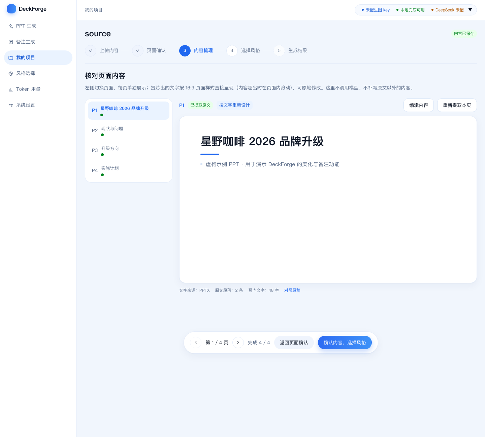
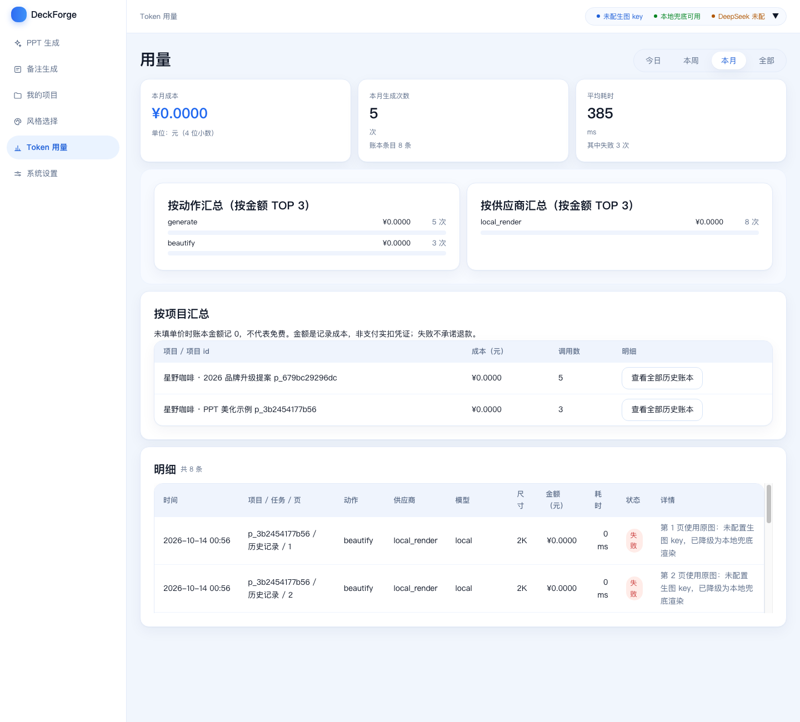

# DeckForge 使用说明

> **下载地址：<https://github.com/dhk1413-del/deckforge>**
> ```bash
> git clone https://github.com/dhk1413-del/deckforge.git
> cd deckforge
> ```
> 本文面向**从 GitHub 下载后自行部署**的使用者：先看第 1 章把服务跑起来，再按第 3–8 章走功能流程，遇到问题看第 11 章。
> 文中截图来自中性演示数据（虚构品牌「星野咖啡」）与零 key 的本地兜底渲染，**不含任何真实项目内容**。

---

## 目录

1. [部署与启动](#1-部署与启动)
2. [配置模型（密钥 / 网络 / 单价）](#2-配置模型密钥--网络--单价)
3. [流程一：文档导入生成](#3-流程一文档导入生成)
4. [流程二：PPT 美化](#4-流程二ppt-美化)
5. [流程三：图片转可编辑](#5-流程三图片转可编辑)
6. [独立模块：PPT 备注](#6-独立模块ppt-备注)
7. [风格库与自定义风格](#7-风格库与自定义风格)
8. [我的项目与恢复](#8-我的项目与恢复)
9. [导出：图片版 / 可编辑版 / 快照](#9-导出图片版--可编辑版--快照)
10. [用量账本与费用口径](#10-用量账本与费用口径)
11. [常见问题与故障排查](#11-常见问题与故障排查)
12. [自检与验收](#12-自检与验收)
13. [附录](#13-附录)

---

## 1. 部署与启动

### 1.1 环境要求

| 组件 | 版本 / 说明 | 是否必需 |
|---|---|---|
| Python | 3.9 及以上（仓库在 3.9.6 上验证） | ✅ 必需 |
| Node.js + npm | 18 及以上（用于前端构建；`server/pptx` 的 PptxGenJS 由脚本自动安装） | ✅ 必需 |
| LibreOffice | `.pptx` 转 PDF 以便逐页预览、美化、备注渲染 | 处理 PPTX 时需要 |
| 中文字体 | PingFang SC / 思源黑体等（本地兜底渲染会挑可用字体） | 建议 |
| Codex CLI | 仅「PPT 美化」的全量可编辑重建需要 | 可选 |
| 精细重建引擎 | 仅「图片转可编辑」需要（第三方 skill） | 可选 |

> 只处理 Markdown / TXT / 粘贴文本时，不需要 LibreOffice；不配任何模型密钥也能跑通全流程（见 §1.7）。

### 1.2 一次性安装

```bash
git clone https://github.com/dhk1413-del/deckforge.git
cd deckforge

# 前端构建（仓库不含构建产物，必须先构建）
cd web && npm install && npm run build && cd ..
```

后端依赖**不需要手动装**：第一次执行 `server/start-lan.sh` 时，脚本会
创建 `.venv` → 安装 `server/requirements.txt` → 安装 `server/pptx` 的 Node 依赖（锁定版本）。

### 1.3 启动 / 停止 / 重启

```bash
bash server/start-lan.sh      # 启动（默认 127.0.0.1:8641，进程脱离终端常驻）
bash server/stop-daemon.sh    # 停止
bash server/stop-daemon.sh && bash server/start-lan.sh   # 重启（改完后端代码后）
```

打开 <http://127.0.0.1:8641>。

> ⚠️ **不要在终端里前台跑** `bash server/run.sh`：实测会话结束时进程会被一起带走，页面随即打不开（`ERR_CONNECTION_REFUSED`）。
> 重启后用 `ps -o pid,ppid -p $(cat data/logs/deckforge.pid)` 确认 **PPID=1**（已脱离终端），并
> `curl -s --noproxy '*' http://127.0.0.1:8641/api/health` 看到 `"ok": true`。

### 1.4 看门狗（服务挂了自动拉起）

`server/watchdog.sh` 每 60 秒探活一次，健康检查不是 200 就用**当前 HOST/PORT**重新拉起，日志写在 `data/logs/watchdog.log`。

```bash
# 启动（macOS 没有 setsid，用新会话 spawn；不要用 nohup ... &，会话结束会被带走）
python3 - <<'PY'
import os, subprocess
subprocess.Popen(["bash", "server/watchdog.sh"], cwd=os.getcwd(), stdin=subprocess.DEVNULL,
                 stdout=subprocess.DEVNULL, stderr=subprocess.DEVNULL, start_new_session=True)
PY

pkill -f 'server/watchdog.sh'     # 停止
tail -f data/logs/watchdog.log    # 看日志
```

实测：手动停掉服务后，30 秒内被自动拉起。

### 1.5 局域网访问与安全

```bash
HOST=0.0.0.0 PORT=8641 bash server/start-lan.sh    # 显式开放；用本机局域网 IP 访问
```

服务**没有登录鉴权**，同一网段的任何人都能改密钥、上传与下载文件。仅在可信网络下短时使用，**不要直接暴露到公网**。
macOS 首次可能弹出防火墙授权，需要允许 Python 接收本地网络连接。

### 1.6 端口与数据目录

| 变量 | 默认 | 说明 |
|---|---|---|
| `PORT` / `DECKFORGE_PORT` | `8641`（`server/run.sh` 默认 `8640`） | 监听端口 |
| `HOST` / `DECKFORGE_HOST` | `127.0.0.1` | 监听地址 |
| `DECKFORGE_DATA` | `<仓库>/data` | 数据目录（SQLite、上传原稿、渲染图、导出件） |

`DECKFORGE_DATA` 指向别处即可做**隔离实例**（测试、验收都用这招，不碰生产库）：

```bash
DECKFORGE_DATA=/tmp/deckforge-demo PORT=8650 bash server/start-lan.sh
```

### 1.7 零 key 也能跑（重要）

不配置任何模型密钥时：

- 内容梳理 → 本地按段落/字数切页并规则抽取标题；
- 出图 → **本地兜底渲染**（Pillow 把结构化内容画成 16:9 PNG），记录 `provider=local_render`、**费用 0**；
- 视觉理解 → 本地取该页色板与插画裁片；
- 全流程与两种导出照常可用。

这也意味着你可以**先零成本把整条链路跑一遍**，确认排版与流程符合预期，再决定是否为某一页调用真实模型。

---

## 2. 配置模型（密钥 / 网络 / 单价）

### 2.1 在界面上填（推荐，热加载）

打开 **系统设置** → 填写密钥 → 点「连通性测试」确认可用。保存后**无需重启**，密钥存在本机数据库里，不会进仓库。


| 卡片 | 用途 | 无密钥时的表现 |
|---|---|---|
| 生图 | 逐页出图（GuaiHub / 阿里百炼等） | 走本地兜底渲染，费用记 0 |
| 文本 | 内容梳理与备注写作（DeepSeek） | 本地规则切页；备注模块明确提示未配置 |
| 视觉 | 读图（Qwen-VL，可指向任意 OpenAI 兼容端点） | 本地色板/插画区域分析 |

### 2.2 用配置文件（可选）

复制 `config/.env.example` 为 `config/.env` 填写 `DEEPSEEK_API_KEY` / `GUAIHUB_API_KEY` / `DASHSCOPE_API_KEY`；
供应商端点与默认模型在 `config/providers.yaml`、`config/text-models.yaml` 里调整。

### 2.3 网络模式

设置页可选 `http_proxy` / `tun` / `none`：

- **境外端点**（OpenAI 兼容中转、Codex）按此模式走代理；
- **国内端点**（阿里百炼、DeepSeek）一律直连，不受影响；
- 用 TUN 类客户端接管全局流量时请选 `tun`（并清空 `HTTP_PROXY`/`HTTPS_PROXY`），否则代理叠加会失败。

### 2.4 生图单价与费用口径

「单价（元/张）」留空时，账本金额记 **0**，界面与导出说明会明确写**「不代表免费」**；
填了单价则每次调用按单价 × 张数记账（失败调用同样记录，不承诺自动退款）。

---

## 3. 流程一：文档导入生成


### 步骤 ① 输入内容


- 拖入 `.md` / `.txt` / `.docx` / `.pdf` / `.pptx`，或直接在「粘贴文本」里贴内容；
- 上传后系统解析全文并给出**建议页数**与字数；PPTX 原稿会按真实页序建立页清单。

### 步骤 ② 页面确认


- 逐页勾选是否参与本次生成（取消勾选只排除任务，原稿仍保留）；
- 每页可以改**标题**、选**版式**（封面 / 并列要点 / 左右对比 / 数据图表 / 时间线 / 总结等）；
- 「保留 N / M 页」显示真实范围；右下角「保存页清单并继续」才会进入下一步。

### 步骤 ③ 内容确认


- 逐页核对标题、正文要点与表格模块，可原地编辑；
- 保存状态（未保存 / 正在保存 / 已保存 / 保存失败）与**修订冲突**（多人多窗口编辑）都会如实提示；
- 内容一旦改动，已有的生成结果会被标记为「基于旧内容」，需要显式重新生成。

### 步骤 ④ 选择风格


- 风格库内置 7 套风格包，鼠标悬停或点「查看」可看大图预览（**预览不等于已选**）；
- 也可以点「自定义风格」上传参考 PPTX/PDF/图片，由系统实测配色与版式生成新风格包（见 §7）。

### 步骤 ⑤ 生成结果


- 左侧是页面栏（结果缩略图 + 每页状态），右侧是当前页大图；点图可**放大**（支持 ←/→ 翻页、Esc 关闭）；
- 顶部按钮：**重新生成本页**（只重跑这一页，其它页与历史版本不受影响）、**缩略总览**；
- 「生成详情」折叠面板里有：总页数、生图张数、总成本、耗时、供应商明细、**警告明细**；
- 下方「导出」区可选图片版、原生可编辑版或按图片版重建（见 §9）。

---

## 4. 流程二：PPT 美化


**核心设计：先预览 3 页 → 你确认 → 再全量生成并重建可编辑版。** 预览阶段只调用 3 页生图，避免一次花掉整册的钱。

### ① 上传内容
拖入 `.pptx` 或 `.pdf`，系统按原页顺序渲染每页图（缓存复用，不重复渲染）。

### ② 页面确认
逐页勾选参与范围；可对个别页打开「保留原页图片素材」——表示**以原页画面为参考**做图生图，
关闭则按该页确认文字重新设计。无可用文字时会退回图生图并在警告里说明。

### ③ 内容梳理



- 左侧切换页面，右侧把该页文字**按最终页面样式**呈现（16:9 页面内滚动），可点「编辑内容」原地修改；
- 「重新提取本页」按原稿重读该页文字，**不调用模型、不补写原文以外内容**；
- 底部胶囊条：翻页、`完成 N / M`、「确认内容，选择风格」。

### ④ 选择风格
同一套风格库；美化支持两种模式：

| 模式 | 做什么 |
|---|---|
| `img2img`（图生图） | 以原页为参考，保留原文字与位置，只换配色、质感与装饰 |
| `redesign`（重新设计） | 用该页确认的文字真源 + 风格令牌重新排版，**不出现真源以外的文字** |

### ⑤ 生成结果


- 左栏逐页结果与状态（`已完成` / `已用原图` / `生成中` / `未生成`），右侧大图可放大、可**对比原稿**；
- **重新生成本页**：非破坏性单页重生成——只重写该页文件，其它页结果与导出一律不动，完成后自动重装配图片版；
- 未配置生图 key 时，逐页生图降级为「原图直通」，结果页会如实标注「已用原图」并写进警告。

要点：**预览不调用 Codex、不产出可编辑版**；确认预览后才进入全量生成，最后用 Codex 重建整册可编辑版。

---

## 5. 流程三：图片转可编辑


适用于「手上只有 PDF/图片/PPTX，想要可编辑对象」的场景。

1. 首页选「图片转可编辑」，上传 PDF / PNG / JPG / PPTX（多张图片按上传顺序拼成一册）；
2. 系统逐页渲染原页图并登记为页面；
3. 在「按图片版重建」页签里勾选要转的页（**未勾选页永不自动转换**）；
4. 引擎探测通过后逐页重建：`prepare → 逐页 dispatch → 页面 build/validate → run finalize`；
   每页产物自带 `validation.json` 校验，**任一页校验不过，整个作业标记为失败**并保留 run 目录与失败明细；
5. 单页约 13 分钟，可取消；中断后用 `resume=true` 复用现场，跳过已完成页。

> 未安装引擎时接口会如实返回「缺哪一件」（CLI / skill 目录），界面直接显示原因，**不会静默回退到别的方式**。

---

## 6. 独立模块：PPT 备注


给**已有的 `.pptx`** 逐页写演讲者备注，再把备注写回副本。**只写备注栏，不改页面内容、版式与母版。**

1. **上传**：拖入 `.pptx`，秒回页清单（不调用模型、不花钱）；
2. **画面识别**：`auto`（只识别文字少的图片页，省钱）/ `all`（每页都识别）/ `off`（只用文本框文字）；
3. **写备注**：可填一句要求让 AI 重写某一页；「只补未完成的页」可续跑；
4. **导出**：生成写回备注栏的副本。

三条硬约定（实现里写死）：

1. 备注内容**只能**来自该页文本框/表格 + 画面识别；两者皆空就不生成并说明原因，**不允许模型凭常识补全**；
2. 渲染 PDF 页数必须等于 pptx 页数，否则拒绝继续（防备注错页），导出前再校验一次；
3. 原备注默认保留，AI 备注以「【演讲备注】」分隔追加在下方。

---

## 7. 风格库与自定义风格


- 内置风格包：商务蓝金 / 双蓝绿清新 / 双蓝橙活力 / 医疗青蓝 / PDF 复刻蓝调 / 深蓝光感科技 / 紫蓝渐变；
- 卡片显示封面、版式数量与标签；**简介只在详情页展示**，列表页保持清爽；
- 详情页给出色板、布局清单与 `style.md` 摘要。

**自定义风格（风格构建）**：首页或风格库点「+ 风格构建」上传参考文件（PPTX / PDF / 图片），系统按
「主题 XML 证据 → 结构统计 → 像素统计 → 视觉定性 → 文案合成」的顺序**实测**出配色、字体、圆角、间距与写作提示词，
落盘成新的风格包；颜色与字号一律来自实测，不由模型编造。

---

## 8. 我的项目与恢复


- 卡片列表：封面、名称、来源与录入方式、页数、创建日期、阶段与状态；右上 `…` 菜单可打开 / 重命名 / 查看用量；
- 底部「下载」按钮取该项目**真实存在的导出记录**（多条时可下拉选择）；没有导出时显示「生成后可下载」；
- 名称/阶段/状态筛选写在地址栏（如 `#/projects?q=示例&stage=2&status=draft`），刷新与后退都保留。

**点击项目会回到它上一次执行到的步骤**，且界面与「PPT 生成」里同一步完全一致：

| 项目属于 | 恢复到 |
|---|---|
| 文档生成流程 | 生成向导的 `resume_step`（输入 / 页面确认 / 内容确认 / 选择风格 / 生成结果） |
| PPT 美化流程 | 有已生成页 → ⑤生成结果；跑过但没产出 → ③内容梳理；从未跑过 → ②页面确认；作业在跑 → 订阅同一作业显示进度 |

---

## 9. 导出：图片版 / 可编辑版 / 快照

| 类型 | 内容 | 说明 |
|---|---|---|
| **图片版 PPT** | 每页整页图铺底，备注栏写「图片版（不可编辑）」 | 本机装配，不调用模型、不额外计费 |
| **原生可编辑 PPT** | 文本 / 形状 / 图表都是 PowerPoint 原生对象 | 由 `server/pptx/render_native.mjs`（PptxGenJS）生成，只嵌入插画裁片，不用整页图冒充排版 |
| **精细重建版** | 第三方引擎逐页还原的可编辑对象 | 只含已转换的页面，产物自带校验文件 |

导出前会先做一次**范围与版本预览**（`POST /export-preview`）并冻结快照：导出的是你确认那一刻的版本；
此后就算你改内容、回退版本或给项目改名，已导出的 PPTX 也不会被改动。

**未就绪的页不会被悄悄塞进导出**：失败、中断、运行中、缺资产、未核对的页面会被明确排除并给出中文原因。

---

## 10. 用量账本与费用口径



- 按**动作 / 供应商 / 项目**汇总，明细表数字等宽；时间范围支持「本月」与「全部」；
- 每条记录带 `provider / model / size / 费用 / 耗时 / 是否成功`；
- **未配置生图单价时金额记 0**，页面显著提示「金额记 0，不代表免费」；
- 失败调用同样入账（真实成本以供应商账单为准），系统**不承诺自动退款**。

---

## 11. 常见问题与故障排查

| 现象 | 原因与处理 |
|---|---|
| 页面打不开 `ERR_CONNECTION_REFUSED` | 服务没在跑。`bash server/start-lan.sh` 重新拉起；并用 §1.4 的看门狗避免再次发生 |
| 改了后端代码没生效 | 后端不会热重载：`bash server/stop-daemon.sh && bash server/start-lan.sh` |
| 改了前端代码没变化 | 需要重新构建：`cd web && npm run build`，然后浏览器 **强制刷新**（Cmd/Ctrl+Shift+R） |
| 上传 PPTX 后没有逐页预览 | 需要本机可用的 LibreOffice（`.pptx → PDF`）。装好后重启服务重试 |
| 「未配置生图 key」 | 属正常降级：可继续用本地兜底渲染；要真实出图请在设置页填密钥并点连通性测试 |
| 出图提示 401 / 403 | 端点与密钥不匹配。阿里云「千问AI平台」按量付费与 Token Plan 套餐**用的是不同地址**，填错必然鉴权失败 |
| 境外模型连不上 | 检查设置页「网络模式」；用 TUN 客户端时选 `tun`，不要叠加 HTTP 代理 |
| 某页生图失败 | 结果页会标「已用原图」；可在「生成详情」看警告明细，或用「重新生成本页」单独重试 |
| 「图片转可编辑」报引擎不可用 | 接口会说明缺 CLI 还是缺 skill 目录；按提示安装后重试，系统不会偷偷换别的引擎 |
| 导出里少了几页 | 未就绪/失败/中断/未核对的页会被明确排除；详情列出页码与原因 |
| 想重置数据 | 停服后备份并清空 `data/`（会删掉项目、账本与密钥，请谨慎） |

---

## 12. 自检与验收

```bash
make verify        # 14 套离线回归 + 前端构建 + 线上只读冒烟（需服务在跑）
make verify-fast   # 不联网、不调模型、不花钱
make lint          # 后端字节码编译 + 前端 tsc
```

单独跑某一套：

```bash
.venv/bin/python tools/test_beautify_v2.py    # 美化：真源/缓存/零 key/单页重生成不破坏其它页
.venv/bin/python tools/test_native_render.py  # 原生渲染器不得伪造内容与数据
.venv/bin/python tools/e2e_mvp.py             # 端到端（要求零 key 基线状态）
.venv/bin/python tools/gen_diagrams.py        # 重新生成本文档里的流程图
```

`make verify` 会把每套回归的「通过 N 项，失败 0 项」汇总打出来，退出码非 0 即失败。

---

## 13. 附录

### 13.1 数据目录

```
data/
├── deckforge.db            SQLite（WAL）；settings 表存你在界面上填的密钥
├── logs/                   server.log / watchdog.log / deckforge.pid
└── files/
    ├── <项目ID>/source.*        上传的原稿
    ├── <项目ID>/pages/          导入页渲染图
    ├── <项目ID>/source-pages/   原稿缩略图与大图（PPTX）
    ├── <项目ID>/beautify/       美化现场：origin/ beauty/ text/ image.pptx state.json
    ├── <项目ID>/<页号>.png      文档生成的逐页结果
    └── exports/                 导出件（文件名含导出时的项目名与唯一 ID）
```

### 13.2 数据库主要表

`projects`（项目与配置）· `slides`（页面与内容修订、原生场景、核对状态）· `jobs`（作业与逐页进度）·
`usage_log`（用量账本）· `exports`（导出记录与快照）· `slide_versions`（页面历史版本）·
`settings`（密钥与热加载配置）· `notes_jobs` / `notes_pages`（备注模块）

### 13.3 接口契约

前后端接口、字段与降级口径以 [`docs/API.md`](API.md) 为准（改接口必须同步该文件）。

### 13.4 键盘操作

| 场景 | 按键 |
|---|---|
| 放大查看结果 | `←` / `→` 翻页，`Esc` 关闭（焦点会回到触发元素） |
| 风格预览 | 方向键翻页，`Esc` 关闭 |
| 生成 / 导出确认框 | `Tab` 循环焦点，`Enter` 提交，`Esc` 取消（取消不会产生任何调用） |
| 表单 | 原生 Tab / Shift+Tab；文本域内 `Enter` 换行 |

### 13.5 声明

- 仓库内的界面截图与风格预览图均为**合成/演示素材**，不含真实项目内容；
- 「内容归模型、格式归代码」：渲染器与前端不写死业务文案，图表只画有真源的数据，取不到就不画并标注来源；
- 本仓库暂未附带开源许可证文件，对外分发前请先补充 `LICENSE` 并确认第三方依赖许可兼容。

---

**下载地址再放一次：<https://github.com/dhk1413-del/deckforge>**
