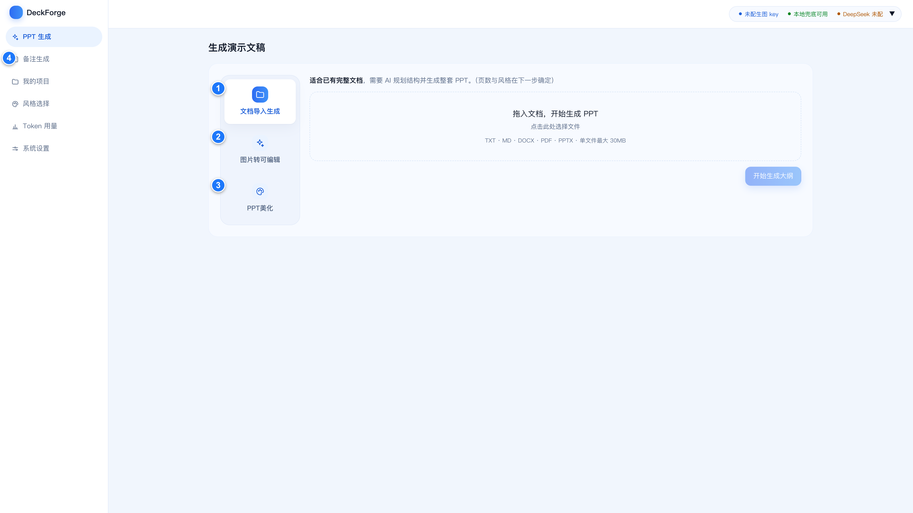
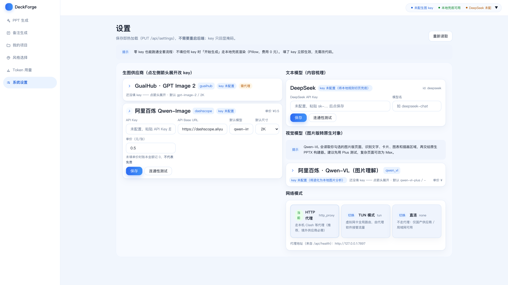
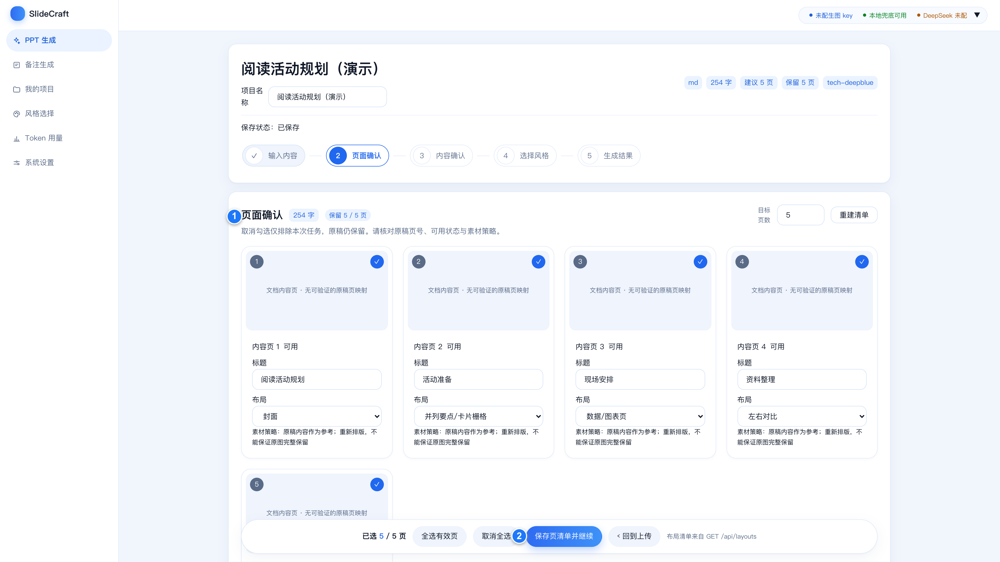
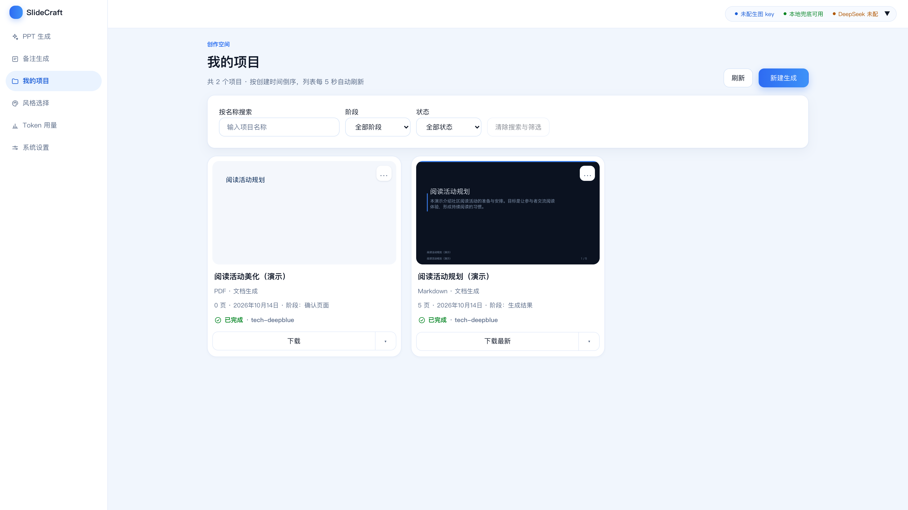

# SlideCraft 使用说明

把文档变成 PPT，为已有 PPT 换风格，把图片转成可编辑页面，或给每页补充演讲备注。

项目下载：[GitHub · SlideCraft](https://github.com/dhk1413-del/slidecraft)


**先选用途：** 文档或文本选“文档导入生成”；已有 PPT 选“PPT美化”；图片资料选“图片转可编辑”；写讲稿选“备注生成”。



首页标注：**① 文档生成　② 图片转可编辑　③ PPT 美化　④ 备注生成**。截图使用中性演示资料；图解用于说明功能，实际界面以系统截图为准。

<!-- pagebreak -->

## 1 用 AI 助手帮你安装


### 方式一 DeepSeek Harness 帮装

1. 从 [DeepSeek 官方页面](https://www.deepseek.com/zh/harness/) 下载 Harness，安装并登录。
2. 新建会话，选择本机工作目录，粘贴下面的安装要求；按提示允许安装所需的操作。
3. 完成后打开它给出的工作台地址。macOS 桌面下载目前面向 Apple 芯片；其他设备按官方页面提供的入口使用。

### 方式二 WorkBuddy 帮装

1. 从 [腾讯官方下载页](https://www.codebuddy.cn/downloads/) 下载 **WorkBuddy**，安装并登录。
2. 新建会话，粘贴同一段安装要求；按提示允许访问安装目录和执行命令。
3. 等它完成后，打开工作台地址。

### 复制这段安装要求

```text
请帮我安装并启动 SlideCraft：
https://github.com/dhk1413-del/slidecraft
先阅读项目 README 和 AGENTS.md，按当前电脑系统安装。
macOS 使用本机终端；Windows 使用 PowerShell 原生安装。
准备 Git、Python 3.12、Node.js 22 最新版和 LibreOffice。
下载到用户目录下的 slidecraft；已有目录不要覆盖或删除。
安装前后端与 PPT 导出依赖并构建前端，按系统启动服务。
先不配模型密钥，用演示文本确认可生成并导出图片版。
检查图片转可编辑与美化可编辑版所需工具，缺少时告诉我。
不要改代码、提交或推送，不要覆盖已有项目和密钥。
最后告诉我安装位置、打开地址和下次启动方法。
```

**安装完成的标志：** 浏览器打开 `http://127.0.0.1:8641`，能看到首页。助手自身的登录或额度，与 SlideCraft 的模型设置分别配置。

<!-- pagebreak -->

## 2 手动安装

### macOS 先准备软件

安装 [Python 3.12](https://www.python.org/downloads/)、[Node.js 22 系列最新版](https://nodejs.org/en/download/archive/v22)（至少 22.12）和 [LibreOffice](https://www.libreoffice.org/download/)，安装后重新打开终端。LibreOffice 用于读取 PPT 文件。

首次使用 Git 时，在终端执行下面的命令，按弹窗完成安装后再继续；已安装时可跳过。

```bash
xcode-select --install
```

### macOS 下载并启动

```bash
cd ~
git clone https://github.com/dhk1413-del/slidecraft.git
cd slidecraft
npm --prefix web install
npm --prefix web run build
bash server/start-lan.sh
```

首次启动自动安装其余依赖，请等待“已就绪”。

### Windows 原生安装

安装 Windows 版 [Python 3.12](https://www.python.org/downloads/windows/)、[Node.js 22 系列最新版](https://nodejs.org/en/download/archive/v22)、[Git](https://git-scm.com/downloads/win) 和 [LibreOffice](https://www.libreoffice.org/download/)。安装 Python 时勾选“Add python.exe to PATH”，随后重新打开 **PowerShell**，依次执行：

```powershell
cd $HOME
git clone https://github.com/dhk1413-del/slidecraft.git
cd slidecraft
py -3.12 -m venv .venv
.\.venv\Scripts\python.exe -m pip install -r server/requirements.txt
npm.cmd --prefix server/pptx ci
npm.cmd --prefix web install
npm.cmd --prefix web run build
$env:PYTHONPATH = "$PWD\server"
.\.venv\Scripts\python.exe -m uvicorn app.main:app --host 127.0.0.1 --port 8641
```

两个系统都在浏览器打开 **http://127.0.0.1:8641**。Windows 运行期间保持这个 PowerShell 窗口打开；停止时按 **Ctrl+C**。不需要激活虚拟环境。

<!-- pagebreak -->

## 3 首次打开与设置

**先体验：** 不填密钥，也可以上传文档、确认内容、生成页面并导出图片版 PPT。本地效果适合先熟悉流程。

**使用 AI：** 左侧点“系统设置”，展开供应商，填入密钥，点“保存”，再点“连通性测试”。不要把密钥发到公共文档里。



**按用途准备：** 整理文档、写备注用文本模型；生成页面、PPT 美化用生图模型；识别图片内容用视觉模型。

图片转可编辑、美化可编辑版还需对应重建工具及本机模型登录，可让安装助手检查并安装。

仅用国内供应商时，可在“网络模式”选择“直连”。按需填写生图单价，方便查看用量；**金额显示 0 不一定代表模型调用免费**。


建议第一次用少量页面走完生成和下载。

<!-- pagebreak -->

## 4 文档生成 先确认页面和内容

### ① 输入内容

首页选择“文档导入生成”，上传 TXT、MD、DOCX、PDF 或 PPTX，点“开始生成大纲”；也可进入“输入内容”使用“粘贴文本”。单个文件不超过 60MB。

### ② 页面确认

勾选要生成的页，修改标题和布局，再点 **“保存页清单并继续”**。不参与的页取消勾选即可。



标注 **①** 是页面选择与编辑区域，**②** 是保存并继续的入口。

### ③ 内容确认

逐页检查标题、要点和数据。需要修改时点“编辑内容”，完成后点“保存 / 重试保存”；显示“已保存”后，点 **“已人工核对，确认内容并继续”**。


标注 **①** 是逐页切换入口，**②** 是内容编辑区域。数字、单位、年份和来源要与原文一致；缺失数据不要补成 0。

<!-- pagebreak -->

## 5 文档生成 选风格并下载

### ④ 选择风格

点“查看”看大图；点 **“选择此风格”** 才会选中。看到“已选中”后，点“继续：开始生成”。


### ⑤ 生成结果

点“生成参与页”，检查确认框里的页数、风格和费用，再确认开始。完成后逐页看结果；要调整时点“重新生成本页”，并再次核对。


### 核对并导出

逐页点 **“已逐项核对，确认此结果”**。向下找到“转换与导出”，选择图片版或当前可用的原生可编辑版；选择全部参与页或所选页，核对版本及排除页面，勾选确认项，再确认导出，点 **“下载已固定产物”**。


图片版保存完整画面，文字不能单独修改。需要修改文字时，选择可用的可编辑输出；按钮不可用时查看旁边的原因。修改内容后，应重新生成并核对结果。

<!-- pagebreak -->

## 6 PPT 美化

适合内容已经做好、希望统一视觉风格的 PPT 或 PDF。

1. **准备文件：** 首页选择“PPT美化”，上传 PPTX 或 PDF，点“开始 PPT 美化”。
2. **选择页面：** 勾选需要美化的页；要参考原图时打开“保留原图”，再点“开始梳理内容”。
3. **确认内容：** 逐页检查文字，必要时点“编辑内容”，完成后点“确认内容，选择风格”。
4. **查看预览：** 选择风格及美化方式。保留原图侧重参考原页，重新设计侧重按确认文字排版。点“生成前 3 页预览”（不足 3 页时按所选页数）。
5. **完成下载：** 点“对比原稿”检查效果，满意后点“确认预览，生成全部所选页面”，完成后下载“图片集 PPT”；有可编辑结果时可下载可编辑版。


**实际美化需要生图模型。** 没配密钥时显示“已用原图”，这时下载的是原图页面，不代表已经换了风格。可编辑版还需要相应重建工具。

点“重新生成本页”可调整单页，点“缩略总览”可检查整册。先核对预览，再决定是否生成全部页面。

<!-- pagebreak -->

## 7 图片转可编辑

适合只有图片、PDF 或整页图片 PPT，希望修改其中的文字和形状。

1. **准备文件：** 首页选“图片转可编辑”，上传 PDF、PPTX 或 PNG、JPG 等图片；多张图片按上传顺序组成页面。
2. **进入重建：** 点击“转可编辑 PPT”，进入“按图片版重建”。这个入口会自动选页并尝试启动，请在确认框核对范围和费用；要调整范围时先取消确认。
3. **确认范围：** 检查“重建引擎”为可用，勾选需要转换的页，点“开始转可编辑”。引擎未准备好时，让安装助手按项目要求配置。
4. **等待结果：** 单页可能需要十余分钟。中途可停止，已完成页会保留；重新进入后可继续处理未完成页。
5. **下载文件：** 完成后点“下载可编辑 PPTX”，打开 PowerPoint 逐页检查文字和形状。


**输出只包含成功转换的页面。** 截图展示转换前的真实状态，没有展示或声称已经完成的转换效果。

已有生成项目也可以在“生成结果”里切到“按图片版重建”，选取当前页面图片继续转换。

<!-- pagebreak -->

## 8 演讲备注

给已有 PPT 配讲稿，备注写入 PowerPoint 的备注栏。

1. **准备文件：** 左侧点“备注生成”，上传 PPTX，点“进入工作台”。
2. **选择方式：** 普通文字页可选“DeepSeek 直接写备注”；图片为主的页面选“先识别图片，再写备注”，选择范围后点“开始识别”。
3. **生成讲稿：** 可填写语气或使用场景，点“一键写完全部 N 页备注”。未完成时可继续写剩余页面。
4. **逐页复核：** 点“下一步：逐页复核”，修改讲稿并保存；检查没有缺页或未保存修改，再点“复核完成，下一步”。
5. **导出下载：** 点“导出带备注的 PPT”，浏览器会下载新文件，也可点击下载链接。


**写备注需要文本模型密钥；图片识别还需要视觉模型。** 原 PPT 页面内容不变，原备注默认保留，新讲稿追加在下面。

在 PowerPoint 中打开下载文件，展开页面下方的“备注”区域，即可查看和修改讲稿。

<!-- pagebreak -->

## 9 日常使用与再次启动

### 项目 风格和用量



- **继续工作：** 点“我的项目”，打开项目回到上次的步骤；卡片下载入口可取回已导出文件。
- **换风格：** 点“风格选择”查看预览；自建风格点“+ 风格构建”，上传参考 PPT、PDF 或图片（也可以截图后直接 `⌘V` / `Ctrl+V` 粘贴图片），检查解析结果后保存到风格库。
- **调整单页：** 点“重新生成本页”；恢复时点对应“版本”按钮回退，之后重新核对。再次生成可能产生费用。
- **查看用量：** 点“Token 用量”，按今日、本周、本月或全部查看；金额以配置单价及实际记录为准。

### 启动 停止与重启

如果由助手安装，使用它告知的实际目录。

**macOS：** 打开终端，执行：

```bash
cd ~/slidecraft
bash server/start-lan.sh
```

停止：`bash server/stop-daemon.sh`；重启：先停止，再启动。

**Windows：** 打开 PowerShell，执行：

```powershell
cd "$HOME\slidecraft"
$env:PYTHONPATH = "$PWD\server"
.\.venv\Scripts\python.exe -m uvicorn app.main:app --host 127.0.0.1 --port 8641
```

停止：在运行窗口按 **Ctrl+C**；重启：停止后再次执行启动命令。

两个系统都打开 **http://127.0.0.1:8641**。

### 在自己的局域网共享

macOS：先停止，再执行 `bash server/start-lan-public.sh`。

Windows：先按 Ctrl+C 停止，再把启动命令中的 `--host 127.0.0.1` 改为 `--host 0.0.0.0` 后重新运行。在系统提示中允许专用网络访问。

其他设备使用这台电脑的局域网 IP 和端口 8641 打开。只在可信的家庭或个人局域网使用。
